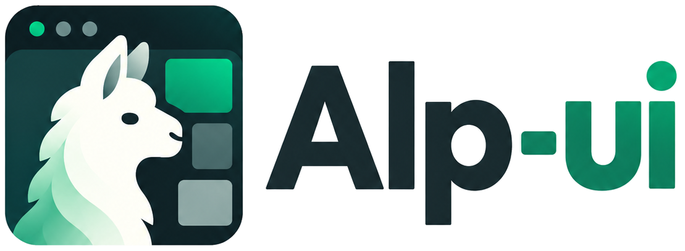
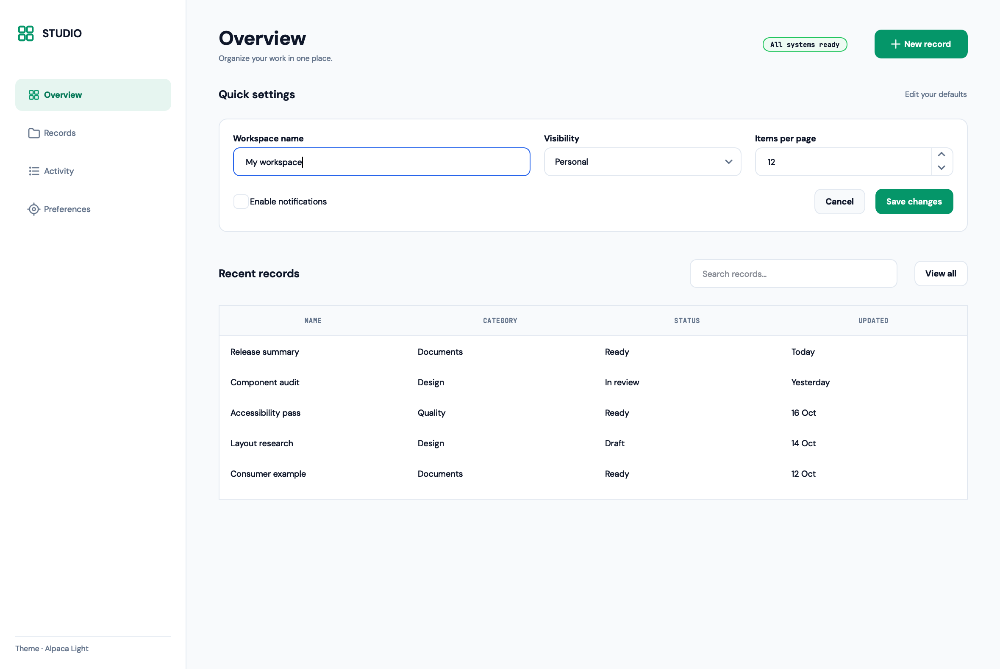
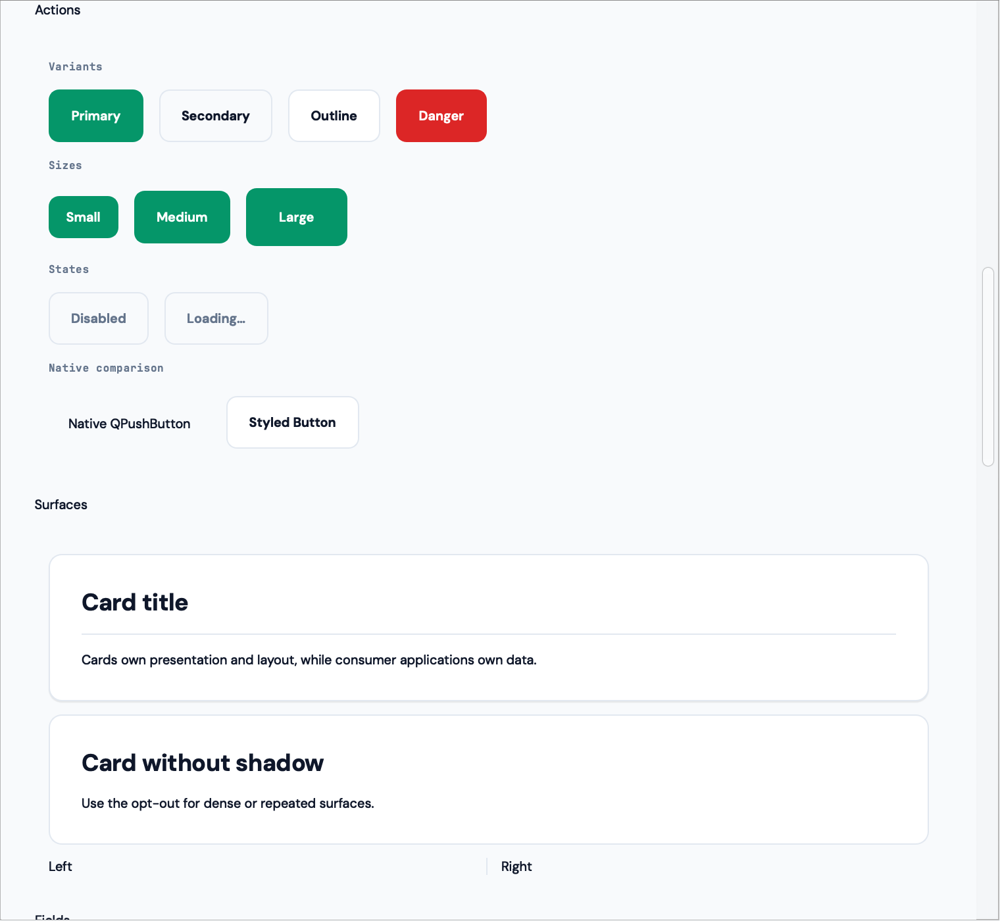
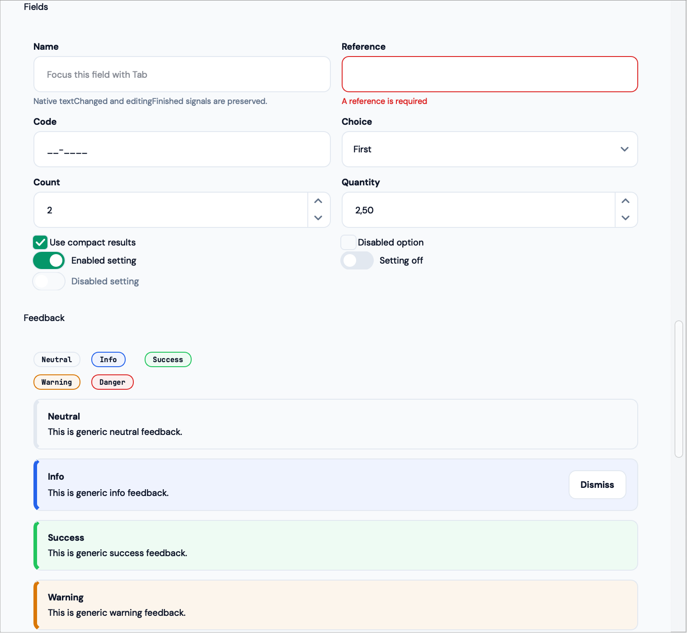
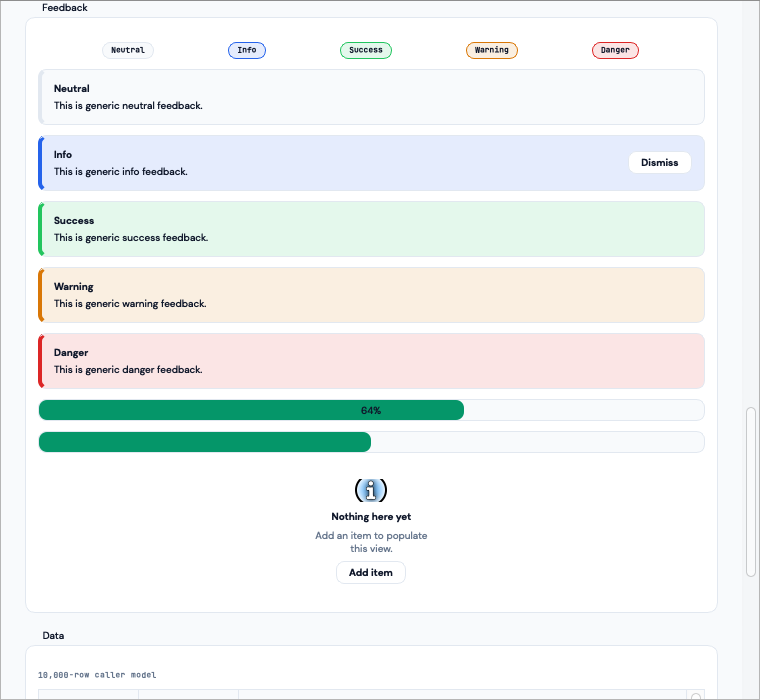
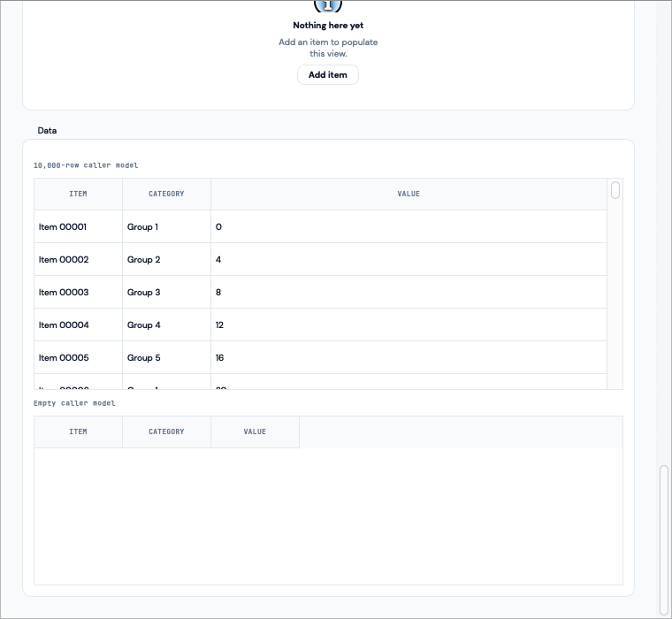
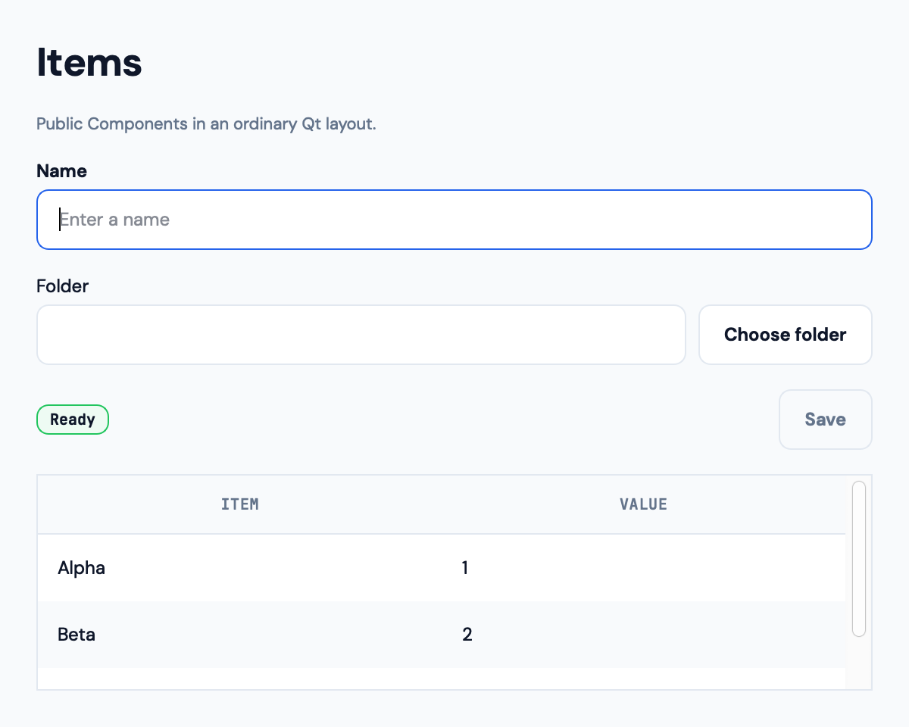

<p align="center">
  <picture>
    <source media="(prefers-color-scheme: dark)" srcset="docs/brand/transparent/lockup-inverse.png">
    
  </picture>
</p>

<h1 align="center">alp-ui</h1>

<p align="center">Native, themeable PySide6 widgets for Python desktop applications.</p>

[](LICENSE)
[](pyproject.toml)
[](.github/workflows/ci.yml)

Build readable forms, dashboards and data views without surrendering native Qt layouts,
signals, keyboard behavior, or model/view architecture. Alpaca Light supplies consistent
colors, typography, and interaction states; your app owns its data and workflows.



## Install and try it

From a repository checkout (no published release yet):

```bash
python -m pip install -e .
```

Create one `QApplication` and install the theme before constructing widgets:

```python
from PySide6.QtWidgets import QApplication, QVBoxLayout, QWidget

from alp_ui.components import Badge, Button, TextInput
from alp_ui.theme import install_theme

app = QApplication([])
install_theme(app)

window = QWidget()
window.setWindowTitle("My Alpaca app")
layout = QVBoxLayout(window)

name = TextInput(label="Name", placeholder="Ada Lovelace")
status = Badge("Ready", intent="success")
clear = Button("Clear name", variant="secondary")
clear.clicked.connect(name.clear)

layout.addWidget(name)
layout.addWidget(status)
layout.addWidget(clear)
window.show()
app.exec()
```

Qt models work directly too. Add this **before** `window.show()` in the example:

```python
from PySide6.QtGui import QStandardItem, QStandardItemModel

from alp_ui.components import DataTable

model = QStandardItemModel()
model.setHorizontalHeaderLabels(["Name", "State"])
model.appendRow([QStandardItem("Ada"), QStandardItem("Ready")])
layout.addWidget(DataTable(model=model))
```

## Components and Gallery

Use `Button`, `Text`, `Card` and `Divider` for structure; `TextInput`,
`NumberInput`, `SelectInput`, `CheckBox`, `Switch`, `FolderPicker` and
`HelpHint` for fields; `Badge`, `Alert`, `ProgressBar` and `EmptyState`
for feedback; and `DataTable` and `Plot` for caller-owned data.
All remain ordinary Qt Widgets, not an application framework.

Explore variants, focus/validation states, and large-model tables in the native Gallery:

```bash
python -m gallery.main
python -m gallery.showcase
```

On Windows, use the project's virtual environment from the repository root:

```powershell
.\\.venv\Scripts\python -m gallery.main
.\\.venv\Scripts\python -m gallery.showcase
```

<p>
  
  
</p>

<details>
<summary>More captured Qt screens</summary>
<p>
  
  
</p>

</details>

These are tracked captures of real PySide6 Widgets, not browser mockups.
The Showcase demonstrates ordinary Qt composition, not an exported sidebar or router.

## Learn more

[Getting started](docs/getting-started.md) ·
[Component API](docs/components.md) ·
[Theme and density](docs/theme.md) ·
[Installed-wheel consumer](examples/consumer_app/README.md) ·
[Brand assets](docs/brand/README.md)

**Compatibility:** Python 3.11–3.13, PySide6-Essentials 6.11.x. `0.1.0a0`
is a pre-release source candidate. Windows x86-64 is the release qualification
target; macOS screenshots are not Windows certification. Alpaca Light is the
only bundled theme, with no supported runtime theme switching.

**License:** alp-ui source is [MIT](LICENSE). Qt/PySide6 and bundled fonts
have separate redistribution obligations; consult the
[third-party notices](docs/legal/THIRD_PARTY_NOTICES.md) before shipping an app.
